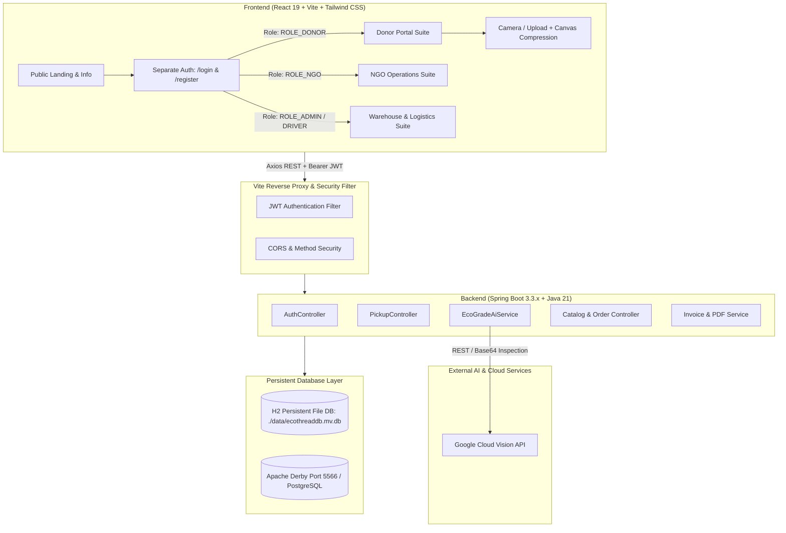
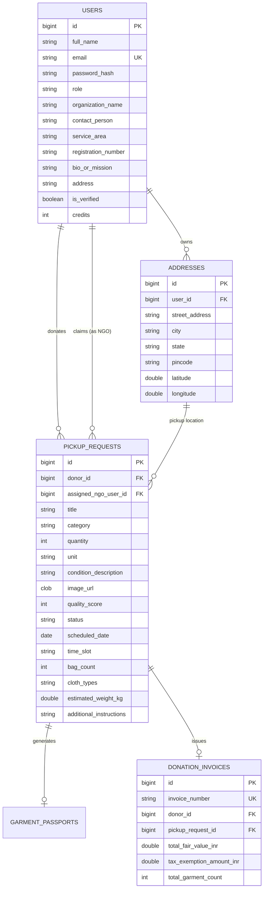

# 🌿 EcoThread — Comprehensive Project & Architecture Documentation
> **Autonomous Circular Fashion & Verified NGO Redistribution Platform**  
> *Campus Waste-to-Worth • Cloud Vision AI Quality Inspection • Mutual Concurrency Locking • 80G Tax Exemption Generation*

---

## 📑 Table of Contents
1. [Project Overview & Mission](#1-project-overview--mission)
2. [High-Level System Architecture](#2-high-level-system-architecture)
3. [Technology Stack & Core Elements](#3-technology-stack--core-elements)
4. [Authentication & Role Separation Architecture](#4-authentication--role-separation-architecture)
5. [Donor Experience & Workflow (`/donor/*`)](#5-donor-experience--workflow)
6. [NGO Operations Hub (`/ngo/*`)](#6-ngo-operations-hub)
7. [AI & Cloud Vision Quality Inspection Engine](#7-ai--cloud-vision-quality-inspection-engine)
8. [Database Schema & Data Persistence](#8-database-schema--data-persistence)
9. [Mutual Concurrency Locking & Race Condition Prevention](#9-mutual-concurrency-locking--race-condition-prevention)
10. [REST API Directory & Data Contracts](#10-rest-api-directory--data-contracts)
11. [Client-Side Image Optimization & Canvas Compression](#11-client-side-image-optimization--canvas-compression)
12. [Environment Setup, Execution & Testing](#12-environment-setup-execution--testing)

---

## 1. Project Overview & Mission

**EcoThread** is a full-stack circular fashion platform designed to eliminate campus textile waste, combat landfill overflow, and alleviate clothing poverty. It establishes a closed-loop supply chain connecting student and community donors directly with verified NGOs, shelters, and sorting warehouses.

### Key UN Sustainable Development Goals (SDGs) Addressed:
- **SDG 12: Responsible Consumption and Production** — Diverting discarded apparel away from landfills into high-utility circular loops.
- **SDG 1: No Poverty** — Providing quality-graded clothing directly to verified NGOs and underserved communities.
- **SDG 13: Climate Action** — Measuring verified carbon emissions saved ($kg\ CO_2$) and water consumption averted ($L$).

---

## 2. High-Level System Architecture

EcoThread adopts a decoupled, stateless **Client-Server Architecture**:



---

## 3. Technology Stack & Core Elements

### Frontend Layer
- **Framework:** React 19 (SPA Architecture)
- **Tooling & Dev Server:** Vite 8.3 (Hot Module Replacement, tree-shaking, production bundle minification)
- **Styling & Tokens:** Tailwind CSS v3 with custom modern palette (Emerald `#059669`, Teal `#0d9488`, Slate `#0f172a`), Outfit & Inter typography.
- **Icons:** `lucide-react` (high-performance SVGs)
- **Routing:** `react-router-dom` v7 with role-guarded `<ProtectedRoute>` wrappers.
- **HTTP Client:** `axios` configured with centralized request/response interceptors for automatic JWT attachment and 401/403 session recovery.
- **Image Processing:** Custom HTML5 Canvas resizer (`imageCompressor.js`) scaling device camera photos to 1024px JPEG (`quality: 0.8`).

### Backend Layer
- **Framework:** Spring Boot 3.3.x on Java 21 (OpenJDK 21).
- **Security:** Spring Security 6 with stateless session management (`SessionCreationPolicy.STATELESS`), BCrypt password hashing, and custom `JwtAuthenticationFilter`.
- **Token Management:** `jjwt` (Java JWT) producing HMAC-SHA512 signed tokens.
- **Data Access:** Spring Data JPA with Hibernate 6.
- **Document Generation:** OpenPDF 1.3 for automated generation of government-compliant 80G tax receipts and PDF passports.
- **API Documentation:** SpringDoc OpenAPI v3 / Swagger UI (`/swagger-ui/index.html`).

### Database & Storage
- **Development/Standard Mode:** H2 Database in persistent disk file mode (`jdbc:h2:file:./data/ecothreaddb`) with zero-loss restarts.
- **Secondary Mode:** Apache Derby Network Server on port `5566` (`application-derby.properties`).
- **Production Mode:** Switchable PostgreSQL profile (`application-prod.properties`).

---

## 4. Authentication & Role Separation Architecture

Rather than merging login and signup into an ambiguous popup, EcoThread separates the onboarding funnel into two distinct, role-aware pages:

### 1. Dedicated Login Page (`/login`)
- Clean split-screen authentication UI with responsive branding.
- Email and password input with show/hide eye toggle.
- Dynamic post-login redirection:
  - Users with `ROLE_DONOR` $\rightarrow$ `/donor/dashboard`
  - Users with `ROLE_NGO` $\rightarrow$ `/ngo/dashboard`
  - Admin/Logistics $\rightarrow$ Respective operational consoles

### 2. Dedicated Registration Page (`/register`)
- Account type switcher: **Donor** (individual/campus) or **NGO / Community Organization**.
- **Donor Fields:** Full Name, Email, Password, Contact Phone.
- **NGO Fields:** Organization Name, Contact Person, Service Area / City, Registration / 80G Number, Mission Statement.
- Automatic BCrypt password encryption before saving to the database.

### 3. Protected Route Security (`ProtectedRoute.jsx`)
Guards every private page by inspecting the authenticated user's role:
- Unauthenticated visitors are redirected to `/login`.
- Donors attempting to access NGO routes are redirected to `/donor/dashboard`.
- NGOs attempting to access Donor routes are redirected to `/ngo/dashboard`.

---

## 5. Donor Experience & Workflow (`/donor/*`)

The donor portal is built specifically for university students, campus hostels, and individuals looking to donate apparel:

| Route | View Component | Key Functionality |
| :--- | :--- | :--- |
| `/donor/dashboard` | `DonorDashboardPage` | Real-time counters (Total Submitted, Pending, Completed, Clothes Recovered), recent activity stream. |
| `/donor/create` | `DonorCreatePage` | Multi-step donation form: item title, category, quantity, unit, location, preferred time slot, camera capture, and live Cloud Vision AI scoring. |
| `/donor/donations` | `DonorDonationsPage` | Active listings filterable by status (`SUBMITTED`, `ACCEPTED`, `COMPLETED`), showing which NGO claimed the lot. |
| `/donor/history` | `DonorHistoryPage` | Historical archive of completed donations with 80G tax exemption receipt downloads. |
| `/donor/impact` | `DonorImpactPage` | Environmental scorecard calculating total liters of water saved and kilograms of $CO_2$ averted. |
| `/donor/profile` | `DonorProfilePage` | Donor contact details, hostel room address, and notification preferences. |

---

## 6. NGO Operations Hub (`/ngo/*`)

The NGO experience functions as a logistics, warehousing, and community allocation center:

| Route | View Component | Key Functionality |
| :--- | :--- | :--- |
| `/ngo/dashboard` | `NgoDashboardPage` | Metrics on available incoming donations, accepted batches, items in transit, and total beneficiaries served. |
| `/ngo/browse` | `NgoBrowsePage` | Live feed of unassigned campus donations with quality scores, photos, donor addresses, and one-click claim. |
| `/ngo/accepted` | `NgoAcceptedPage` | Warehouse management of accepted donations with stage progress controls (`PICKUP_SCHEDULED` $\rightarrow$ `RECEIVED` $\rightarrow$ `INSPECTED` $\rightarrow$ `COMPLETED`). |
| `/ngo/collections` | `NgoCollectionsPage` | Field operations, driver pickup schedules, and campus drop-box route coordination. |
| `/ngo/impact` | `NgoImpactPage` | Verified social impact: total garments distributed, families assisted, and ESG compliance figures. |
| `/ngo/profile` | `NgoProfilePage` | NGO trust credentials, official license numbers, operational hours, and contact details. |

---

## 7. AI & Cloud Vision Quality Inspection Engine

The core automated quality gate is powered by **Google Cloud Vision API** combined with EcoThread's **EcoGrade Decision Engine**:

```
[Donor Camera / Photo Upload]
             │
             ▼
[Canvas Compressor (1024px, JPEG 0.8)]
             │
             ▼
[POST /api/ai/assess-garment]
             │
             ├──▶ Google Cloud Vision API (LABEL_DETECTION, OBJECT_LOCALIZATION)
             │
             ▼
[EcoGrade AI Scoring Algorithm]
             │
             ├── Score ≥ 50: Grade A/B (Approved for NGO Community Redistribution)
             └── Score < 50: Grade C (Downgraded to Industrial Textile Shredding & Recycling)
```

### Assessment Metrics:
1. **Garment Type & Count Detection:** Recognizes jackets, shirts, denim, blankets, and counts individual garments in the frame.
2. **Defect Penalty Deductions:** Subtracts score points for tears (-35), permanent stains (-25), missing hardware/buttons (-15), and severe color fading (-10).
3. **Threshold Gate:** 
   - **Quality Score $\ge 50$:** Tagged for immediate NGO redistribution.
   - **Quality Score $< 50$:** Tagged for circular mechanical recycling into insulation blankets and yarn.

---

## 8. Database Schema & Data Persistence

### Database Entities & Relationships



### Large Object Handling (`CLOB`)
To support high-resolution base64 data URLs without database truncation errors (`Value too long for column IMAGE_URL CHARACTER VARYING(255)`), the following fields use `@Lob` mapped to native `CLOB`:
- `PickupRequest.imageUrl`
- `GarmentPassport.imageUrl`
- `InventoryItem.imageUrl`
- `NgoPartner.imageUrl`

---

## 9. Mutual Concurrency Locking & Race Condition Prevention

In a multi-organization environment, two NGOs could simultaneously attempt to accept the same high-value donation batch. EcoThread enforces strict atomic concurrency control:

```java
@Transactional
public synchronized PickupRequest acceptDonationByNgo(Long pickupId, Long ngoUserId, String notes) {
    PickupRequest pickup = pickupRequestRepository.findById(pickupId)
            .orElseThrow(() -> new IllegalArgumentException("Donation lot not found"));

    // Concurrency Lock: Verify the batch has not already been claimed
    if (pickup.getAssignedNgoUser() != null || pickup.getStatus() == PickupStatus.ACCEPTED) {
        String claimedBy = pickup.getAssignedNgo() != null 
                ? pickup.getAssignedNgo().getName() 
                : "another organization";
        throw new IllegalStateException("This donation has already been accepted by " + claimedBy);
    }

    // Bind atomic ownership
    pickup.setAssignedNgoUser(ngoUser);
    pickup.setStatus(PickupStatus.ACCEPTED);
    return pickupRequestRepository.save(pickup);
}
```

If Organization B submits a claim request after Organization A has already initiated transaction commitment, the request fails with `HTTP 409 Conflict / 400 Bad Request` specifying the claiming organization name.

---

## 10. REST API Directory & Data Contracts

### 🔑 Authentication (`/api/auth`)
- `POST /api/auth/register` — Registers Donor or NGO accounts with role-specific metadata.
- `POST /api/auth/login` — Returns JWT token, user ID, role, and profile summary.
- `GET /api/auth/me` — Fetches fresh profile of the authenticated bearer.
- `PUT /api/auth/profile` — Updates user profile, address, and organization bio.

### 📦 Donations & Pickups (`/api/pickups`)
- `POST /api/pickups` — Creates a verified donation lot (Donor).
- `GET /api/pickups` — Retrieves donations submitted by donor or accepted by NGO.
- `GET /api/pickups/available` — Feeds unassigned donations to verified NGOs (`status = SUBMITTED`).
- `GET /api/pickups/accepted` — Lists donations assigned to the logged-in NGO.
- `POST /api/pickups/{id}/accept` — Atomically locks and assigns a lot to the NGO.
- `POST /api/pickups/{id}/decline` — Releases/declines a donation batch.
- `PATCH /api/pickups/{id}/status` — Advances warehouse logistics status.
- `GET /api/pickups/stats/donor` — Returns live metrics for donor overview.
- `GET /api/pickups/stats/ngo` — Returns live metrics for NGO operations.

### 🤖 AI Quality Inspection (`/api/ai`)
- `POST /api/ai/assess-garment` — Sends base64/URL image to Cloud Vision for automated defect grading.

### 📄 Invoices & 80G Receipts (`/api/invoices`)
- `GET /api/invoices/my` — Lists all verified tax receipts for the donor.
- `GET /api/invoices/download/{id}` — Streams dynamically generated PDF receipt with 80G tax exemption certificate.

---

## 11. Client-Side Image Optimization & Canvas Compression

Mobile and webcam photos often exceed 10MB (producing over 13 million characters in base64). EcoThread includes an offscreen HTML5 canvas compression module:

```javascript
// frontend/src/utils/imageCompressor.js
export async function compressImage(file, maxDimension = 1024, quality = 0.8) {
  // 1. Reads File via FileReader
  // 2. Loads into an offscreen Image element
  // 3. Downsamples dimensions proportionally to max 1024x1024
  // 4. Encodes to JPEG at 0.8 quality
  // Result: Shrinks ~10MB camera images down to 80-150KB
}
```

This guarantees fast uploads, reduced network latency, and prevents browser memory spikes.

---

## 12. Environment Setup, Execution & Testing

### Prerequisites
- **Java:** OpenJDK 21 or higher
- **Node.js:** v18+ and npm
- **Maven:** Bundled via `./mvnw`

### Quick Start (Local Development)

```bash
# 1. Start Backend (Terminal 1)
cd backend
JAVA_HOME=/path/to/openjdk@21 ./mvnw spring-boot:run

# 2. Start Frontend (Terminal 2)
cd frontend
npm install
npm run dev -- --port 5588
```

### Access Ports
- **Frontend App:** `http://localhost:5588`
- **Backend API:** `http://localhost:5577`
- **H2 Web Console:** `http://localhost:5577/h2-console` (JDBC URL: `jdbc:h2:file:./data/ecothreaddb`)
